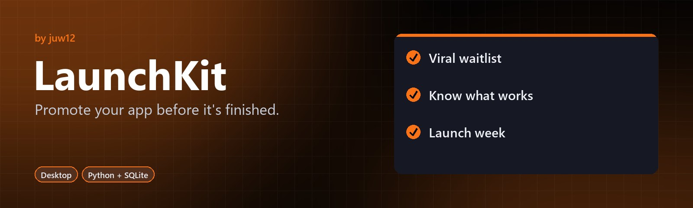

<!-- HERO:START -->

  

  <b>Promote your app before it's finished.</b> 
  A viral waitlist, reward emails, an AI build-in-public social manager and a launch-week plan.

  <a href="#highlights">Highlights</a> ·
  <a href="https://github.com/juw12">More by juw12</a>

  
  
  

<table>
  <tr>
    <td width="33%" valign="top">
      <b>Viral waitlist</b> 
      Every friend you invite moves you up the line.
    </td>
    <td width="33%" valign="top">
      <b>Know what works</b> 
      Tracked links show which post brought each signup.
    </td>
    <td width="33%" valign="top">
      <b>Launch week</b> 
      Product Hunt and Show HN checklists, plus an AI social media manager.
    </td>
  </tr>
</table>
<!-- HERO:END -->

## Get it on your device

- **Windows:** [`LaunchKit-Windows-Setup.exe`](https://github.com/juw12/launchkit/releases/download/desktop/LaunchKit-Windows-Setup.exe) (no admin needed; if Windows says it protected your PC, choose *More info → Run anyway*), or without installing [`LaunchKit-Windows-Portable.zip`](https://github.com/juw12/launchkit/releases/download/desktop/LaunchKit-Windows-Portable.zip).
- **Mac:** [`LaunchKit-macOS-AppleSilicon.dmg`](https://github.com/juw12/launchkit/releases/download/desktop/LaunchKit-macOS-AppleSilicon.dmg) (M1 and newer) or [`LaunchKit-macOS-Intel.dmg`](https://github.com/juw12/launchkit/releases/download/desktop/LaunchKit-macOS-Intel.dmg). The first time, macOS blocks it because it is not notarized: **System Settings → Privacy & Security → Open Anyway**.
- **Android:** [`LaunchKit-android.apk`](https://github.com/juw12/launchkit/releases/download/android/LaunchKit-android.apk): open the file on the phone and allow your browser to install apps once.
- **iPhone:** open https://juw12.github.io/launchkit/ in Safari, tap Share, then **Add to Home Screen**.

The Windows, Mac and Android apps are the web app in its own window ([`desktop/`](desktop/README.md), [`android/`](android/README.md)) and change with it. Each build is opened on GitHub's machines before it is published: on Windows and on a Mac the page loads, the app starts and can store data; on an Android emulator it installs, opens and stays up. They are not code-signed or notarised, and no real phone or PC has run them yet.

## About

**Pre-launch growth app for indie developers.** Promote your product before it's finished:
a viral waitlist with referral rewards, confirmation and reward emails, an AI build-in-public
social media manager, tracked links that show which posts bring signups, and a launch-week
campaign planner. One Python file, standard library only, SQLite.

## Run it as a desktop app (Windows)
1. Install [Python 3.10+](https://www.python.org/downloads/) (tick "Add python.exe to PATH").
2. Double-click `LaunchKit.bat`.

It opens in its own window, already logged in. The first run creates `.env` with a random admin
password; edit `.env` to add email (Resend or SMTP) and AI keys. Close the console window to stop.
Your data stays in `launchkit.db` next to the app. On Mac/Linux: `python3 app.py`.

## Run it as a server
1. Copy `.env.example` to `.env` and set at least `ADMIN_TOKEN` (12+ characters)
2. `python launchkit.py` (or `start.bat`)
3. Landing page: http://localhost:8000 - Admin: http://localhost:8000/admin

## The admin
A clean dashboard with a sidebar (light and dark mode follow your system setting):
- **Overview** - getting-started checklist, waitlist numbers, 14-day signup chart, top referrers, setup status
- **Posts** - write, schedule and auto-post build-in-public content; share links for every platform
- **Marketing** - tracked-link analytics, campaigns, launch-week plan and checklist, AI repurposing
- **Emails** - broadcast to your waitlist, test delivery, outbox
- **Settings** - product details, sharing, privacy, integration status and the embed code

## The growth loop
1. Post build-in-public content (Admin -> Posts). AI writes it from your notes, or use templates.
   Links carry ?utm_source=<platform>; {count}, {days_left}, {link} stay live until posting.
2. Visitor joins -> confirmation email -> confirms -> welcome email with position + referral link.
3. A friend joins via that link and confirms -> referrer moves up BUMP_PER_REFERRAL spots and gets a
   "friend joined" or "reward unlocked" email (1 / 3 / 10 invites - edit MILESTONES in launchkit.py).
4. Waitlist hits 10/50/100/250... -> "we hit N" draft posts auto-created -> back to step 1.
5. Launch day: Admin -> Emails -> Broadcast to every confirmed subscriber (personalised, with unsubscribe).

## Marketing (Admin -> Marketing)
- **Tracked links**: every post links to `/go/<code>`. Clicks are counted (link-preview bots ignored, one per
  visitor) and signups are attributed to the post they came from - also when they sign up later (30-day cookie).
- **Dashboard**: clicks, signups and conversion per campaign, per platform and per post, plus clicks by hour
  ("best time to post", once you have 30+ clicks).
- **Campaigns**: content plans and launch campaigns create one automatically; create your own and pick it when composing.
- **Launch-week campaign**: posts at launch -7/-3/-1/0/+1/+7 days on the platforms you pick (uses `launch_date`),
  plus a checklist: launch assets, Product Hunt (day starts 12:01 AM PT), Show HN (must link a working product,
  not a waitlist), switching links to your product, the launch email (opens the broadcast form pre-filled).
- **Repurpose with AI**: paste a changelog/blog post -> a native draft for each selected platform.
- **Settings**: `share_image_url` = image for link previews (Open Graph / Twitter cards);
  `post_link_target` = where post links send people (empty = waitlist page; set to your app after launch).

## Anti-abuse / privacy
- Referrals only count after the friend confirms their email (REQUIRE_VERIFICATION=1)
- Same-network referrals are not credited; Gmail dots/+tags are de-duplicated; per-IP signup rate limit
- Public referral link (?ref=) is separate from the private status page (/s/<token>)
- Re-entering an existing email never reveals the status page - the link is emailed instead
- Every marketing email has an unsubscribe link + List-Unsubscribe / one-click headers

## Email delivery
- Resend: set RESEND_API_KEY and EMAIL_FROM on a domain you verified in Resend
- SMTP: set SMTP_HOST / PORT / USER / PASSWORD / SECURITY and EMAIL_FROM
- Neither: "console mode" - emails are printed in the terminal and shown in Admin -> Emails (good for local testing)
Use Admin -> Emails -> "Send test email" to check delivery.

## AI writer
Any OpenAI-compatible chat API: OpenAI, OpenRouter, Groq, Together, or a free local Ollama
(AI_BASE_URL=http://localhost:11434/v1). Set AI_MODEL to a model your provider offers.
The AI is told not to invent features/metrics and to use [placeholders] for things you must fill in.

## Social posting
Bluesky and Discord post automatically at the scheduled time. X / LinkedIn / Threads / Reddit become
"due" and get a one-click Share button (their posting APIs need paid/approved developer access).

## Embed on an existing site
    

## Deploy
1. A small Linux VPS (or any host that runs Python 3.10+). Copy this folder there.
2. `.env`: strong `ADMIN_TOKEN` (12+ chars - the app refuses to listen publicly with a weak one),
   `BASE_URL=https://your-domain`, `HOST=127.0.0.1`, `TRUST_PROXY=1`, `TIMEZONE=<your zone>`.
3. Put Caddy in front for HTTPS - see `Caddyfile.example`. Don't expose the app directly: Python's
   built-in server is meant to sit behind a proxy.
4. Keep the app running with systemd (or your host's process manager).
5. Backups: a copy of the database is made every 24 h into `BACKUP_DIR` (newest 14 kept). Also copy that
   folder off the server now and then - Admin -> "Download backup" gives you a file instantly.
Upgrading: replace `launchkit.py` - the database migrates automatically.

## Security notes
- Admin login uses a random session cookie; 5 wrong passwords lock that IP out for 15 minutes.
  Changing ADMIN_TOKEN logs out every session.
- `TRUST_PROXY=1` only behind your own proxy - otherwise anyone could fake their IP address.
- `/privacy` is a generated template describing what the app actually collects. Set `contact_email`
  (or `privacy_url` for your own policy) in Settings, and check the requirements where your users live.

## Tests
`run_tests.bat` (or `python -m unittest discover -s tests -v`) - 20 end-to-end tests with fake email/AI
services; nothing real is sent. Run them after every change.

## License

Released under the [MIT License](LICENSE) © 2026 Juwen Lie. Contributions are welcome under the same license; see the [contributing guide](https://github.com/juw12/.github/blob/main/CONTRIBUTING.md) and [Code of Conduct](https://github.com/juw12/.github/blob/main/CODE_OF_CONDUCT.md).
